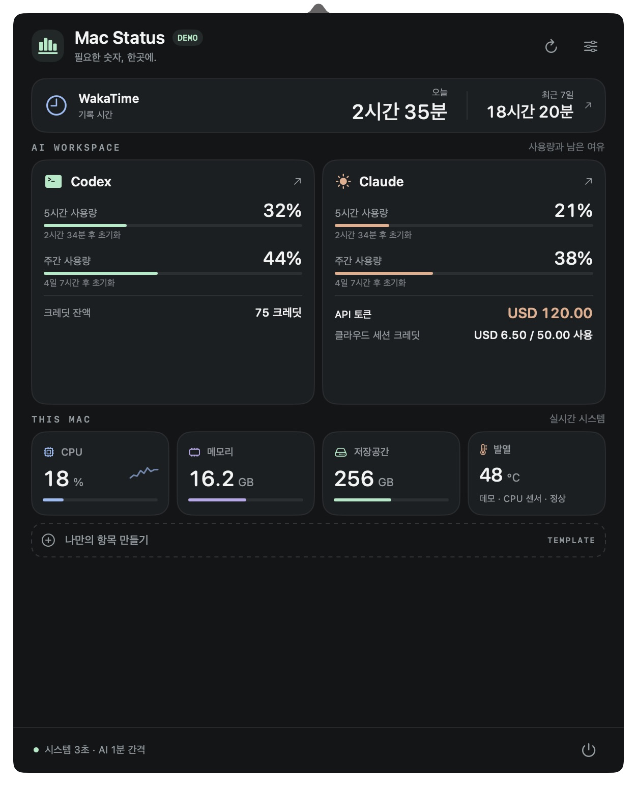
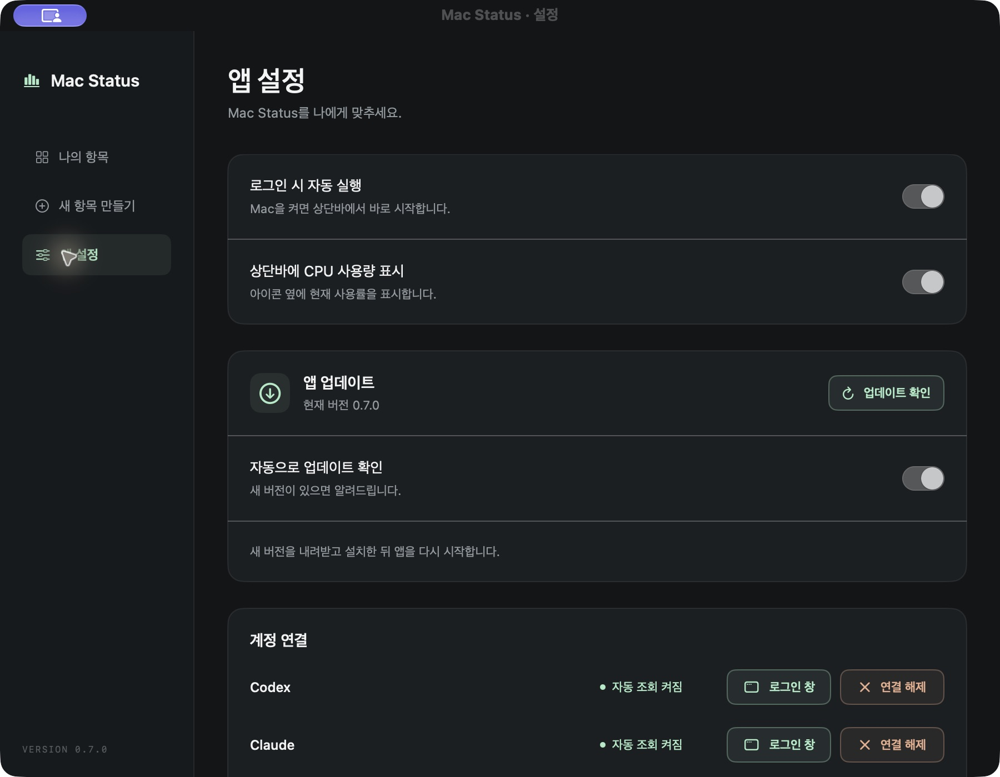
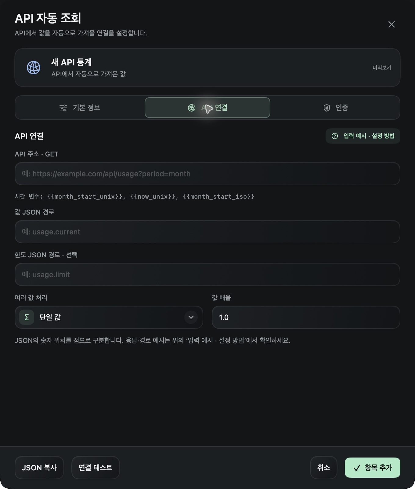
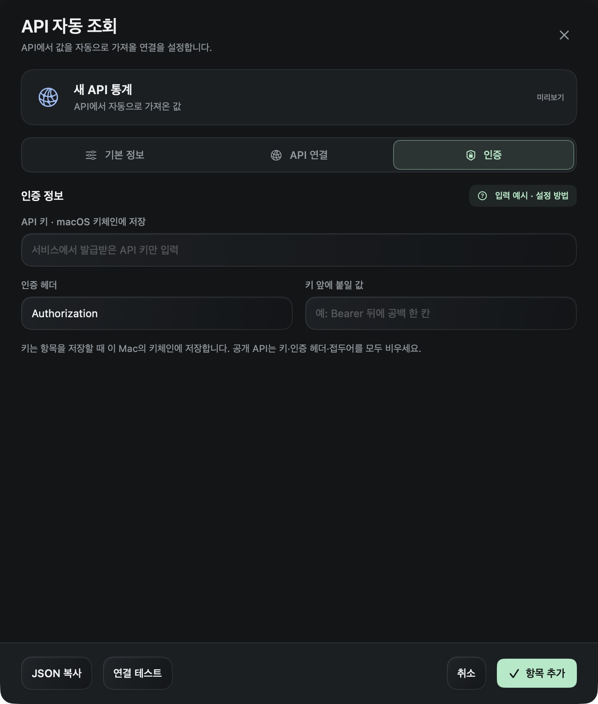
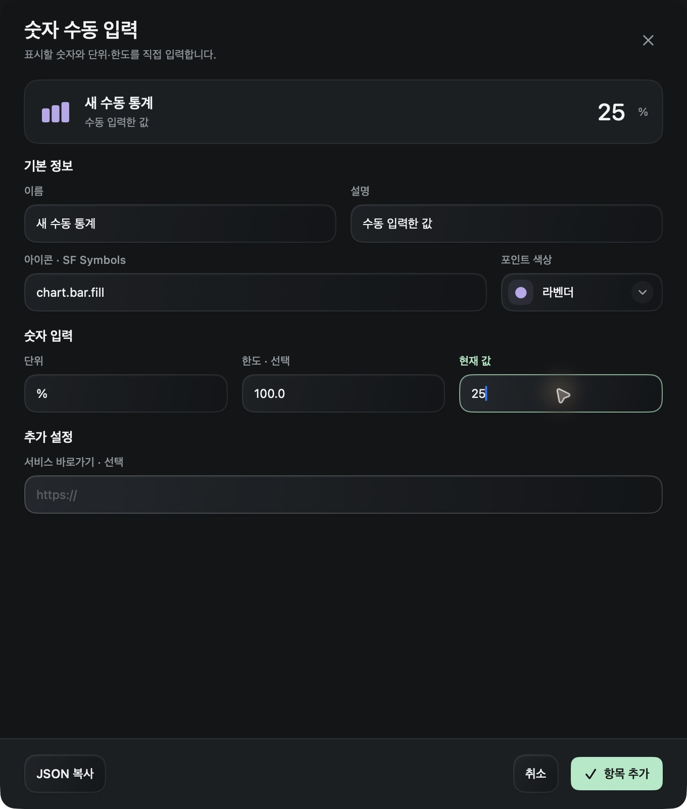
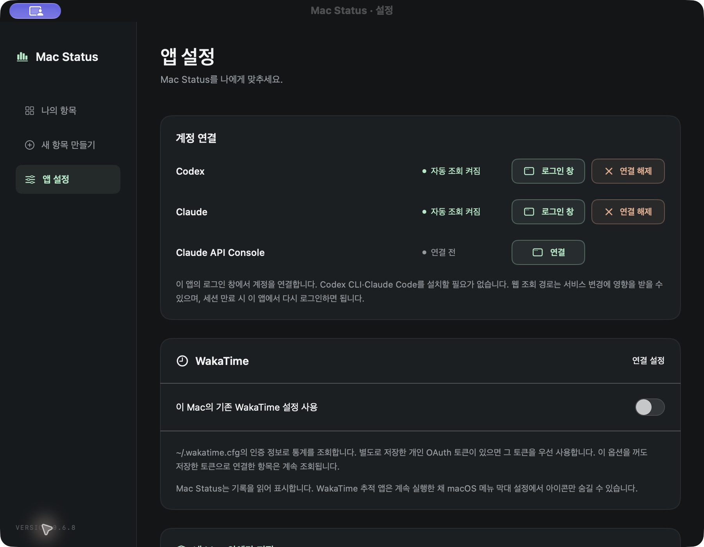
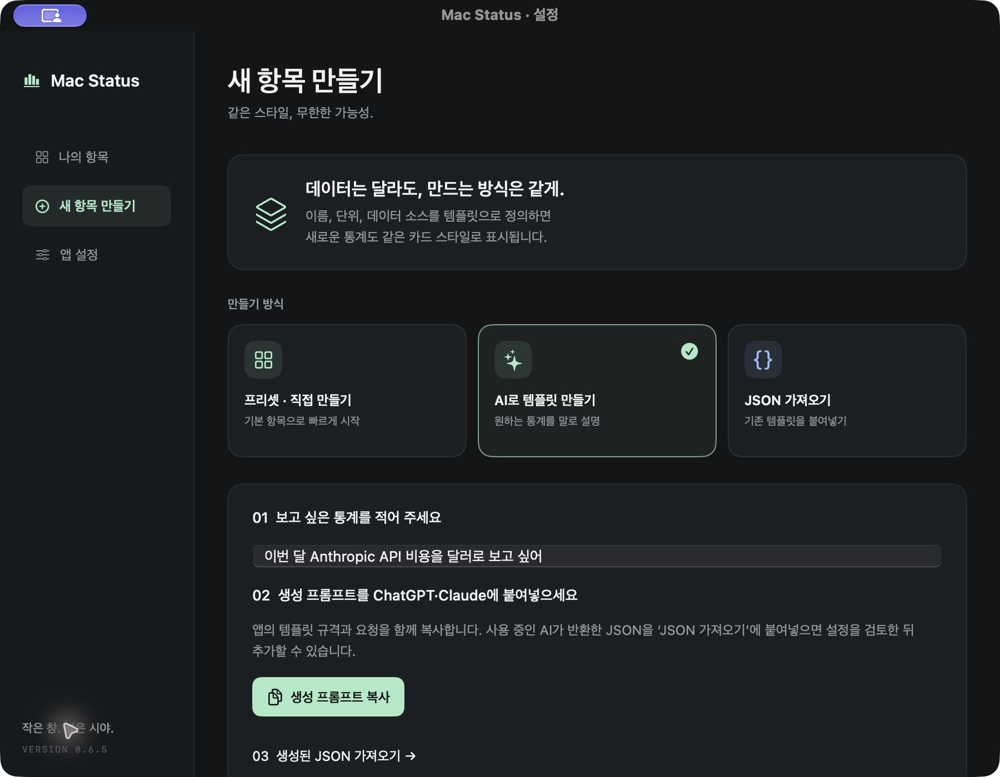
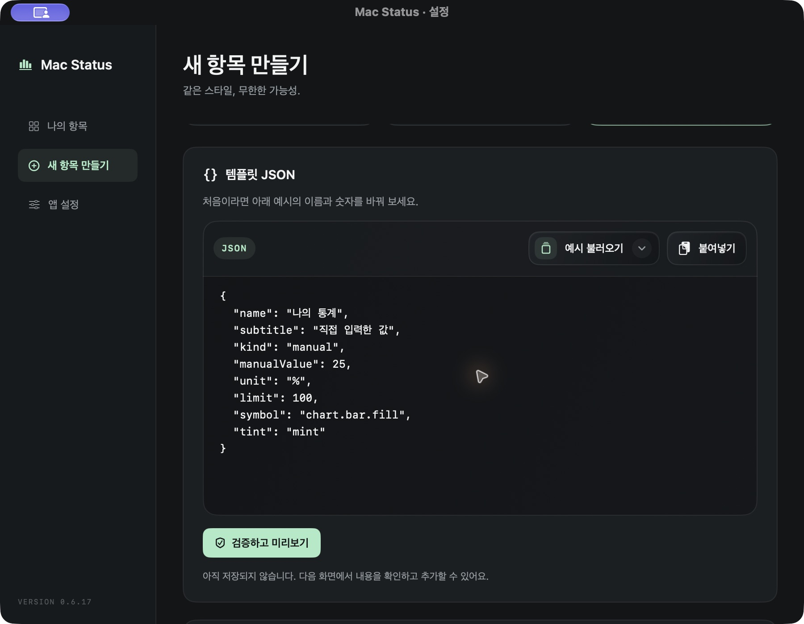
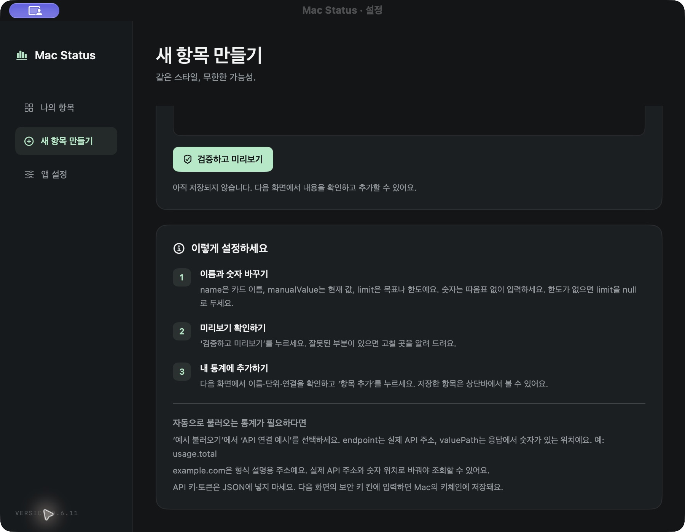

# Mac Status

Codex·Claude 사용량, WakaTime 기록 시간과 Mac의 상태를 한곳에서 확인하는 macOS 네이티브 상단바 앱입니다. 기본 통계와 함께, JSON 템플릿으로 원하는 서비스의 통계를 추가할 수 있습니다.

<p align="center">
  
</p>

<p align="center"><em>실제 네이티브 앱을 실행해 캡처한 화면입니다. 공개용 예시 데이터(DEMO)를 사용하며 실제 계정·잔액·활동 기록은 포함하지 않습니다.</em></p>

## 설치와 실행

**macOS 14 이상에서 Mac Status 앱 하나만 설치하면 됩니다.** 사용자는 Xcode, Homebrew, Codex CLI, Claude Code를 설치할 필요가 없습니다.

**다운로드:** [DMG 설치 파일](https://github.com/WongyuKoh/Mac-Status/releases/latest/download/Mac-Status.dmg) · [ZIP 압축 파일](https://github.com/WongyuKoh/Mac-Status/releases/latest/download/Mac-Status.zip) · [릴리스 및 변경 내역](https://github.com/WongyuKoh/Mac-Status/releases)

첫 공개 배포는 [v0.6.2](https://github.com/WongyuKoh/Mac-Status/releases/tag/v0.6.2)입니다.

현재 설치 파일은 Apple Silicon(M1 이상) Mac용입니다. `Mac-Status.dmg`를 열어 앱을 Applications로 드래그하거나 아래 ZIP 방식으로 설치할 수 있습니다.

1. `Mac-Status.zip`을 풀고 `Mac Status.app`을 Applications 폴더로 옮깁니다.
2. 앱을 엽니다. Dock 대신 상단바에 차트 아이콘이 나타납니다.
3. 상단바 아이콘을 누르면 CPU·메모리·저장공간·발열 통계가 자동으로 표시됩니다.
4. AI 사용량은 앱의 Codex·Claude 카드에서 계정을 연결합니다.

로그인은 서비스 계정의 데이터를 보기 위한 최초 설정이며 별도 프로그램을 설치하는 과정은 없습니다. API 비용·토큰에는 해당 조회 API의 읽기 권한이 있는 키나 자격 증명이 별도로 필요합니다.

로그인·설정 창을 열면 Dock에도 앱이 표시되며, 해당 창을 모두 닫으면 상단바에만 남습니다.

상단바 아이콘은 통계 팝업만 엽니다. 이미 열어 둔 설정·로그인 창을 함께 앞으로 가져오지 않으며, 설정 창은 설정 버튼이나 해당 창을 직접 눌렀을 때 표시합니다.

설정에서 로그인 시 실행을 켤 수 있습니다. macOS가 승인을 요구하면 시스템 설정의 로그인 항목에서 허용하세요. 현재 빌드는 로컬 실행을 위한 ad hoc 서명을 사용하며 배포용 Developer ID 서명·공증은 포함하지 않습니다.

### 앱 업데이트

**0.7.0부터 앱 안에서 새 버전 확인·다운로드·설치 후 재시작을 진행할 수 있습니다.** 설정 → 앱 설정 → **앱 업데이트 → 업데이트 확인**을 누르거나 앱 메뉴의 **업데이트 확인**을 사용하세요. 새 버전이 있으면 업데이트 창에서 다운로드와 설치를 진행합니다. 업데이트 기능은 앱에 포함된 [Sparkle](https://sparkle-project.org/)을 사용하므로 별도 프로그램을 설치할 필요가 없습니다.

**자동으로 업데이트 확인**은 새 버전을 확인하고 알려 주는 옵션입니다. 이 옵션만 켰다고 앱이 조용히 교체되지는 않으며, 다운로드·설치는 업데이트 창에서 선택합니다. 배포 피드와 ZIP의 EdDSA 서명을 확인하고, ZIP은 압축 해제 전에 검증합니다. 이 업데이트 서명은 Developer ID 서명·공증과 구분되며, 현재 빌드의 ad hoc 서명 상태는 그대로입니다.

여러 업데이트 후보가 있어도 확인 시점의 배포 피드에서 현재 Mac과 호환되는 가장 높은 빌드 번호를 선택합니다. 중간 버전을 차례로 설치할 필요 없이 최신 버전의 전체 앱으로 바로 업데이트합니다. 비교에는 피드 순서·게시 날짜·표시용 버전명이 아닌 `CFBundleVersion`을 사용하며, 현재 설치본과 같거나 낮은 빌드는 설치하지 않습니다.

**0.6.25 이하 버전에는 업데이트 기능이 없습니다.** 이 버전을 사용하고 있다면 0.7.0을 한 번 내려받아 기존 앱을 교체하세요. 그다음 배포부터는 앱의 업데이트 기능을 사용할 수 있습니다.

<details>
<summary>앱 업데이트 설정 화면 보기</summary>
<p align="center">
  
</p>
</details>

## 제공 통계

| 항목 | 데이터와 동작 |
| --- | --- |
| Codex | 5시간·주간 사용률과 초기화 시각, 크레딧 잔액·사용량. 계정에서 제공하는 항목만 표시 |
| Claude | 5시간·주간·모델별 사용률과 초기화 시각, API 토큰(USD 잔액), 클라우드 세션 크레딧. 계정에서 제공하는 항목만 표시 |
| WakaTime | 오늘·최근 7일 기록 시간, 오늘의 프로젝트·언어별 통계 |
| CPU | 전체 코어의 실제 CPU 사용률. 연속 샘플의 차이로 계산 |
| 메모리 | 앱·와이어드·물리 압축 메모리를 합한 사용량과 전체 용량 |
| 저장공간 | 사용자 데이터가 있는 APFS 볼륨의 실제 사용 공간. 정리 가능한 공간을 포함한 여유도 상세 화면에 표시 |
| 발열 | 지원되는 AppleSMC CPU 센서의 온도. 접근할 수 없으면 macOS 발열 상태를 표시 |
| OpenAI API 비용 | 조직의 이번 달 API 비용, USD |
| OpenAI API 토큰 | 조직의 이번 달 API 입력 토큰 |

카드를 누르면 상세 통계를 볼 수 있습니다. 설정에서 항목의 표시 여부와 순서를 바꾸거나 새 항목을 추가하세요. 시스템 항목은 3~30초, AI 구독은 기본 1분, API는 기본 5분 간격으로 갱신됩니다.

**앱 설정 → 상단바 수치 표시**에서 아이콘 옆에 표시할 통계를 고릅니다. CPU·메모리·저장공간, Codex·Claude의 5시간·주간 사용량, 직접 추가한 통계 등을 선택할 수 있습니다. 비율을 제공하는 항목은 **값 그대로 / 사용률(%)**로 표시 방식을 바꿀 수 있으며 선택은 다음 실행에도 유지됩니다. 조회할 수 없거나 숨김·삭제된 항목은 `—`, JSON의 빈 값은 `null`로 표시하고 다른 통계로 자동 전환하지 않습니다. 긴 값은 상단바에서 줄여 표시하며 전체 값과 통계 이름은 툴팁에서 확인할 수 있습니다.

API 비용·토큰 프리셋은 필요할 때 추가합니다. 연결되지 않은 기존 OpenAI 기본 항목은 업데이트 시 숨기며 설정에서 다시 켤 수 있습니다. 메인 화면은 WakaTime, AI 두 항목과 시스템 네 항목을 함께 볼 수 있도록 넓고 간결하게 배치합니다. 스크롤 막대는 메인·상세·편집 창에서 숨깁니다.

Codex·Claude 이름 옆에는 계정에서 확인한 **구독 플랜**을 표시합니다. Claude는 선택한 워크스페이스의 구독 정보를 사용합니다. 플랜 정보가 제공되지 않으면 **플랜 미제공**으로 표시합니다.

### 항목 편집

입력칸은 곡선 모서리와 은은한 음영, 민트색 포커스 테두리로 구분합니다. 드롭다운에는 색상·시계 등의 아이콘과 우측 화살표를 표시하며, 버튼 전체를 눌러 선택할 수 있습니다. 편집 창은 화면 높이에 맞춰 열리며, 작은 화면에서는 추가 설정을 별도 탭으로 보여 줍니다.

드롭다운 목록은 어두운 배경과 항목별 아이콘을 사용하고, 현재 선택한 항목을 민트색 체크와 굵은 글씨로 구분합니다. 상단바 항목 목록에는 AI 사용량·이 Mac·활동 기록·API 통계 등의 그룹 제목이 표시됩니다. 키보드 이동·선택과 메뉴가 열린 동안의 통계 갱신 처리는 유지합니다.

저장·연결 테스트·JSON 복사 때 빠진 항목이나 잘못된 입력이 있으면 해당 칸에 빨간 `*`와 짧은 안내가 표시됩니다. 오류가 있는 탭에도 표시하고 첫 오류가 있는 탭으로 이동하며, 값을 고치면 해당 표시가 사라집니다. 연결 테스트 결과는 편집창 아래에 표시합니다.

- **API 숫자 통계:** 서비스의 API에서 숫자를 읽어 자동 갱신합니다. **기본 정보 / API 연결 / 인증**에서 주소·`A.B.C` 같은 숫자 경로·보안 키·새로고침 간격을 설정하며, 현재 값을 수동으로 입력하는 칸은 없습니다.
- **숫자 수동 입력:** 현재 값·단위·선택 한도와 서비스 바로가기를 직접 설정합니다. 값이 바뀌면 직접 수정하며, API 주소·인증·연결 테스트·자동 새로고침 설정은 표시하지 않습니다.

API 연결에서는 값·한도 JSON 경로 아래에 각각 계산식을 넣을 수 있습니다. `A.B.C`에서 25를 읽고 값 계산식에 `value * 2`를 입력하면 결과는 50입니다. 각 계산식의 `value`는 해당 경로에서 읽은 숫자이며, 사칙연산과 괄호를 지원합니다. 계산식을 비우면 원래 숫자를 사용합니다. 단일 값 또는 합계를 추출한 뒤 계산식을 적용하고 마지막에 기존 값 배율을 곱합니다. 0으로 나누거나 계산할 수 없는 경우 카드·상세·상단바에 `null`을 표시하며 이전 정상 값으로 대체하지 않습니다.

프리셋이나 JSON의 `kind`로 정한 방식에 맞춰 편집 화면이 열립니다. API 자동 조회와 숫자 수동 입력 사이를 전환하는 선택기는 없으며, API 연결 안에서는 **숫자 통계 / JSON 값 그대로**를 선택할 수 있습니다. **JSON 값 그대로**는 숫자·문자열·참/거짓·객체·배열을 계산 없이 표시합니다. 공개 API는 키 없이 사용하고, 인증이 필요할 때만 보안 키를 설정합니다.

**API 연결**과 **인증** 탭의 제목 옆에 있는 **입력 예시 · 설정 방법**을 누르면 응답 JSON과 입력값, 필요한 서비스 설정을 볼 수 있습니다. API 주소·숫자 위치·인증 헤더에는 입력 형식 예시도 표시합니다. 안내의 `example.com`과 숫자는 가상의 설명용 데이터이며 실제로 조회되는 서비스가 아닙니다. 예시를 열어도 현재 설정이나 보안 키가 자동으로 채워지지 않습니다.

API는 JSON을 반환하는 GET 주소와 필요한 쿼리 조건을 사용합니다. 숫자 통계는 해당 경로의 숫자로 계산하고, JSON 값 그대로는 선택한 값을 표시합니다. 키에는 그 조회 API를 읽을 수 있는 권한이 있어야 하며 조직·프로젝트 범위, 유효 기간과 접근 제한도 조회 대상에 맞아야 합니다. Bearer 인증은 `Authorization`과 끝에 공백이 있는 `Bearer `, `x-api-key` 인증은 `x-api-key`와 빈 접두어를 사용합니다. 인증 없는 공개 API는 키·인증 헤더·접두어를 모두 비웁니다.

예를 들어 응답이 `{"A":{"B":{"C":42}}}`이면 두 표시 방식 모두 JSON 경로에 `A.B.C`를 입력해 `42`를 가져옵니다. **JSON 값 그대로**는 값을 읽지 못했을 때 이전 값이나 `0`을 표시하지 않습니다. `null`로 상태를 구분하고 다음 조회가 성공하면 새 값으로 갱신합니다. 자세한 입력 예시와 제한은 [템플릿 문서](docs/Templates.md#api-주소json-경로로-값-불러오기)를 참고하세요.

<details>
<summary>API 연결·인증 입력 안내 화면 보기</summary>
<p align="center">
  
  
</p>
</details>

<details>
<summary>새 입력칸과 항목 편집 화면 보기</summary>
<p align="center">
  
</p>
</details>

### Codex·Claude 계정 연결

<p align="center">
  
</p>

연결 상태와 동작 버튼을 분리하고, 로그인 창과 연결 해제 버튼을 서로 다른 색의 테두리로 구분합니다. 위 화면은 공개용 데모입니다.

1. 앱에서 Codex 또는 Claude 카드를 누르고 로그인 창을 엽니다.
2. 창에 표시된 각 서비스의 공식 웹페이지에서 본인의 계정으로 로그인합니다.
3. 로그인 완료를 감지하면 사용량을 자동으로 확인합니다. 필요한 경우 **연결 확인**을 눌러 다시 조회합니다.

로그인 창의 차트 버튼으로 같은 세션의 서비스 사용량 페이지를 직접 열 수도 있습니다. Claude 워크스페이스가 여러 개인 계정은 통계를 볼 워크스페이스를 선택합니다.

로그인 화면은 macOS에 내장된 WebKit으로 표시합니다. 각 서비스의 세션은 Mac Status 전용 저장소에 분리해 보관하고 다음 실행에 재사용합니다. 다른 앱이나 Safari·Chrome의 쿠키, Codex·Claude Code의 로그인 정보를 읽지 않습니다. 연결 해제는 이 앱에 저장된 해당 서비스의 세션만 지우며 다른 앱이나 브라우저의 로그인에 영향을 주지 않습니다.

세션이 만료되면 앱 안에서 다시 로그인하세요. 조회는 사용량을 읽는 GET 요청만 수행하며 AI 작업을 시작하지 않습니다. 구독 사용률은 API 토큰 수나 API 청구 금액과 다른 통계입니다.

앱 내부 로그인이 차단되면 **브라우저에서 보기**로 서비스의 실제 사용량 페이지를 열 수 있습니다. 이 기능은 웹페이지를 직접 확인하는 대안이며, 브라우저 로그인을 앱으로 가져오거나 자동 연동으로 처리하지 않습니다.

일반 웹페이지는 앱 안에서 표시할 수 있지만 인증 기능에는 별도의 제한이 있습니다. [Apple의 패스키 문서](https://developer.apple.com/documentation/authenticationservices/supporting-passkeys)는 일반 앱의 웹뷰에서 연결된 도메인을 사용하는 조건을 설명하며, [Google OAuth 정책](https://developers.google.com/identity/protocols/oauth2/policies#use_secure_browsers)은 개발자가 제어하는 내장 웹뷰를 통한 인증을 허용하지 않습니다. 따라서 Google 패스키가 표시되지 않는 문제를 웹뷰 설정만으로 해결한다고 보장하지 않습니다. 앱은 로그인 팝업을 별도 창으로 유지해 원래 페이지의 인증 흐름을 보존하며, Google 화면에서는 내장 로그인 제한과 다른 인증 방법 안내를 표시합니다.

**연결 지원 범위:** 서비스 웹페이지의 사용량 조회 경로를 이용하는 실험적 연동입니다. 서비스 변경·계정 권한·네트워크에 따라 조회가 중단될 수 있습니다. Google 로그인과 일부 조직 SSO는 내장 웹뷰를 제한할 수 있으며 모든 로그인 방식의 동작을 보장하지 않습니다. 브라우저에서 로그인해도 그 세션이 앱으로 자동 공유되지는 않습니다. 실제 계정 로그인 완료 여부는 사용자의 환경에서 확인해야 하며 자동 검증에는 계정 인증을 포함하지 않습니다. 로그인이 막히거나 한도가 제공되지 않으면 안내를 표시하며 임의의 수치를 만들지 않습니다.

### AI 한도·크레딧·클라우드 작업

- **5시간과 주간 한도:** 각각의 사용률·남은 비율·초기화 시간을 구분합니다. 계정에서 특정 한도를 제공하지 않으면 숫자 대신 확인할 수 없음을 표시합니다.
- **클라우드 작업:** Codex Cloud처럼 서버에서 수행하는 작업도 일반 사용량과 한도를 공유합니다. Claude의 클라우드 작업도 플랜 사용량에 포함됩니다. 별도 원격 작업 통계가 없는 경우 횟수나 사용률을 따로 추정하지 않습니다. [OpenAI 사용량 안내](https://learn.chatgpt.com/docs/pricing), [Claude 클라우드 작업과 사용량](https://support.claude.com/en/articles/16761823-claude-cowork-and-chat-are-one-claude)
- **Codex 크레딧:** 서비스가 알려 주는 잔액은 크레딧 단위이며 달러 비용이 아닙니다. 실제 사용량·월 한도도 응답에 있는 경우 함께 표시합니다. 잔액만으로 이미 쓴 총량이나 클라우드 작업만의 비용을 계산하지 않습니다.
- **Claude API 토큰:** 현재 웹 워크스페이스가 반환한 잔액을 메인 카드의 **API 토큰** 항목에 표시합니다. 서버가 제공한 USD 금액을 그대로 사용하며, 원시 토큰 개수로 환산하지 않습니다. API 전용 크레딧의 출처·잔액은 Console 조직 연결로 확인합니다. 잔액 조회 권한이 없거나 응답이 지연되어도 5시간·주간 사용량 조회는 유지합니다.
- **Claude 클라우드 세션 크레딧:** 계정 응답에 별도 제공되는 경우 사용액·잔액·만료 상태를 표시합니다. 모든 클라우드 작업의 사용량이나 기본 구독 한도를 뜻하지 않습니다.
- **추가 사용:** 구독의 추가 사용 지출·월 한도와 크레딧 잔액은 서로 다른 통계입니다. **추가 사용** 행은 화면에 표시하지 않습니다. [Claude 사용 크레딧 안내](https://support.claude.com/en/articles/12429409-manage-usage-credits-for-paid-claude-plans)

### Claude API Console 연결

Claude 카드의 상세 화면 또는 설정 → 계정 연결에서 **API 크레딧 연결**을 누르면 앱 전용 Console 로그인 창이 열립니다. Console의 API 조직 잔액과 제공되는 크레딧 내역을 조회하며, 연결 후 Claude 카드에 API 잔액을 함께 표시합니다. 조직이 여러 개면 조회할 조직을 직접 선택합니다. API 조직은 Claude 채팅 조직과 구분하며 브라우저 쿠키를 가져오지 않습니다.

실제 Console 계정의 로그인과 잔액 조회를 확인했습니다. Google 인증은 원래 Console 화면을 유지한 별도 창으로 처리하며, 진행되지 않으면 **이메일 로그인으로 다시 시도**를 사용할 수 있습니다. 조직 SSO와 계정별 권한에 따른 제한은 남아 있습니다.

현재 공식 안내에서 Pro는 월간 API 크레딧 대상이 아니며 Max·Team은 해당 Console 조직 연결이 필요합니다. 앱은 금액만으로 크레딧의 지급 원천을 추정하지 않고 Console 응답이 구독 제공 크레딧으로 구분한 경우에만 그렇게 표시합니다. [Claude 구독 API 크레딧 안내](https://support.claude.com/en/articles/17154008-monthly-api-credits-for-max-and-team-plans)

### CPU 온도와 발열 상태

온도 센서 접근은 Mac 모델과 macOS 버전에 따라 다릅니다. 읽을 수 있는 CPU 센서가 있으면 최고 온도를 °C로 표시합니다. 센서에 접근할 수 없으면 **정상·따뜻함·높음·매우 높음** 중 macOS가 제공하는 상태를 보여 줍니다. 발열 상태를 추정 온도로 변환하지 않으며 관리자 권한이나 별도 헬퍼도 요구하지 않습니다.

### WakaTime

WakaTime 항목은 오늘의 기록 시간과 최근 7일 합계, 오늘의 프로젝트·언어별 통계를 보여 줍니다. 조회에는 **`read_summaries` 권한의 WakaTime 개인 OAuth 토큰**이 필요합니다. 일반 API 키로 통계를 조회하지 않습니다. 공식 문서는 API 키를 플러그인의 활동 전송용으로 안내하고, 앱·스크립트·연동에는 OAuth 토큰을 사용하도록 명시합니다. [WakaTime 공식 인증 안내](https://wakatime.com/developers#authentication)

설정 → 앱 설정 → WakaTime → **연결 설정**에서 **개인 OAuth 토큰 발급 페이지 열기**를 누르세요. [개인 토큰 페이지](https://wakatime.com/oauth)에서 `read_summaries` 권한의 토큰을 발급해 입력칸에 붙여넣고, **연결 테스트** 후 저장합니다. 토큰은 macOS 키체인에 보관하며, 입력칸을 비워 저장하면 기존 토큰을 유지합니다. 본인 계정에 접근하는 개인 사용에는 OAuth 앱을 게시할 필요가 없습니다. 다른 사용자가 WakaTime 로그인으로 앱을 승인하는 공개 OAuth 연결은 별도의 앱 게시와 사용자별 인증 흐름이 필요하며, 현재 Mac Status는 각 사용자가 본인의 개인 토큰을 직접 저장하는 방식입니다. [WakaTime 공식 인증 안내](https://wakatime.com/developers#authentication)

**기존 설정의 개인 OAuth 토큰 사용** 옵션은 `~/.wakatime.cfg`에 개인 OAuth 토큰이 있을 때만 사용하며, 키체인에 저장한 토큰이 우선입니다. 기존 API 키가 발견되면 요청을 보내지 않고 개인 토큰 연결을 안내합니다. Mac Status는 기존 설정 파일이나 활동 추적용 API 키를 변경하지 않습니다. 날짜가 빠진 응답은 전체 7일 사용량으로 표시하지 않습니다.

Mac Status는 WakaTime 서버의 기록을 읽어 표시하며 활동 추적기를 대체하지 않습니다. 기존 WakaTime 추적 앱을 계속 실행하면서 **시스템 설정 → 메뉴 막대 → 메뉴 막대에서 허용 → WakaTime**을 끄면 별도 아이콘만 숨길 수 있습니다. [Apple 메뉴 막대 설정 안내](https://support.apple.com/en-euro/guide/mac-help/mchlad96d366/27/mac/27), [WakaTime 추적 앱 안내](https://github.com/wakatime/macos-wakatime#usage)

### API 토큰·비용

OpenAI API 프리셋에는 **조직 사용량을 조회할 수 있는 Admin API Key**가 필요합니다. 일반 모델 호출용 키 또는 ChatGPT 구독 로그인으로는 조직 비용을 조회할 수 없습니다. 연결 설정의 보안 키 필드에 입력하세요. [OpenAI Admin API 공식 문서](https://developers.openai.com/api/reference/administration/overview)

- 비용은 `/v1/organization/costs`의 금액을 합산합니다.
- 토큰은 `/v1/organization/usage/completions`의 입력 토큰을 합산합니다. 출력 토큰이 필요하면 항목을 추가하고 `valuePath`를 `data.*.results.*.output_tokens`로 설정하세요.
- 기간은 UTC 기준 이번 달입니다. API 청구 반영 지연은 서버의 집계에 따릅니다.
- API 응답이 여러 페이지로 나뉘면 불완전한 합계를 표시하지 않고 조회 범위를 조정하도록 안내합니다.

Anthropic용 비용·입력 토큰 프리셋도 새 항목 화면에서 추가할 수 있습니다. JSON 예시는 `Templates/` 폴더에 있으며 기본 예시는 Admin API Key를 사용합니다. 공식 문서는 조직 조회용 자격 증명으로 Admin 키 외에 `org:admin` OAuth 토큰과 워크스페이스에 묶이지 않은 개인·서비스 계정 키도 안내합니다. 워크스페이스 범위 키는 사용할 수 없으며, 다른 자격 증명을 쓰면 문서에 맞춰 인증 헤더도 설정해야 합니다. 구독 사용률과 API 비용은 구분합니다. [Anthropic Usage and Cost API 공식 문서](https://platform.claude.com/docs/en/manage-claude/usage-cost-api)

## 나만의 항목 만들기

<p align="center">
  
</p>

실제 네이티브 앱의 기본 프리셋 화면입니다. **API 자동 조회**는 서비스를 연결해 숫자를 자동으로 읽고, **숫자 수동 입력**은 원하는 값을 직접 기록합니다. 위의 세 카드에서는 프리셋·AI 템플릿 생성·JSON 가져오기 중 만들기 방식을 선택할 수 있습니다.

1. 대시보드에서 **나만의 항목 만들기**를 누릅니다.
2. 원하는 통계를 설명하고 **생성 프롬프트 복사**로 요청을 복사합니다.
3. ChatGPT·Claude 등에서 해당 요청으로 JSON 템플릿을 만듭니다.
4. 반환된 JSON을 앱에 붙여 넣고 내용을 확인합니다.
5. 필요하면 보안 키를 별도 입력하고 연결을 확인한 뒤 저장합니다.

AI 호출은 앱에 내장되어 있지 않으므로 별도 생성 API 비용이 발생하지 않습니다. 템플릿은 실행 코드가 아닌 읽기 전용 데이터 연결 설정입니다. 공식 API가 없는 통계는 **숫자 수동 입력** 항목으로 만들 수 있습니다.

**JSON 가져오기**에는 바로 수정할 수 있는 수동 입력 예시가 들어 있습니다. **예시 불러오기**에서 API 연결 예시로 바꿀 수도 있습니다. 입력란 아래의 3단계 안내를 따라 미리보기를 확인하고 항목을 추가하세요. 잘못된 내용은 주황색 오류 카드에 고칠 항목과 함께 표시합니다.

<details>
<summary>JSON 예시와 설정 안내 화면 보기</summary>
<p align="center">
  
  
</p>
</details>

예시:

```json
{
  "name": "내 서비스 사용량",
  "subtitle": "이번 달 요청 수",
  "kind": "http",
  "symbol": "chart.bar.fill",
  "tint": "mint",
  "unit": "회",
  "limit": 10000,
  "endpoint": "https://example.com/api/usage",
  "valuePath": "usage.requests",
  "aggregation": "first",
  "authHeader": "Authorization",
  "authPrefix": "Bearer ",
  "refreshInterval": 300
}
```

`example.com`은 형식 설명용 주소이며 실제 서비스 주소와 JSON 경로로 바꿔야 합니다.

| 설정 | 의미 |
| --- | --- |
| `kind` | `http` 또는 `manual` |
| `valuePath` | 숫자 경로. `usage.total`, `data.0.value`, `data.*.value` |
| `aggregation` | 숫자 하나는 `first`, 여러 숫자의 합은 `sum` |
| `limit`, `limitPath` | 고정 한도 또는 응답에서 읽을 한도 경로 |
| `multiplier` | 숫자에 적용할 배율. 예: 센트 → 달러는 `0.01` |
| `headers` | 버전 등 비밀이 아닌 추가 HTTP 헤더 |
| `authHeader`, `authPrefix` | 인증 헤더와 접두어. `x-api-key` 인증이면 접두어는 빈 문자열 |
| `refreshInterval` | 새로고침 주기, 초 단위 |
| `manualValue` | 숫자 수동 입력 항목의 현재 값 |

URL의 `{{month_start_unix}}`, `{{now_unix}}`, `{{month_start_iso}}`는 실행할 때 UTC 기준 시각으로 치환됩니다. API 연결은 HTTPS GET을 사용합니다. 로컬 도구에는 루프백 주소의 HTTP도 허용합니다.

전체 규격과 서비스별 예시는 [템플릿 문서](docs/Templates.md)를 참고하세요.

## 데이터와 개인정보

- 항목 설정과 표시 순서는 macOS의 로컬 UserDefaults에 저장합니다.
- API 키는 macOS Keychain에 저장하며 JSON 템플릿에 포함하지 않습니다.
- Codex·Claude 연결은 사용자가 각 연결 버튼을 누른 후 활성화됩니다.
- Codex·Claude 웹 로그인 세션은 이 앱의 WebKit 저장소에 보관합니다. 다른 앱·브라우저의 자격 증명을 가져오지 않습니다.
- WakaTime의 기존 설정 사용을 켠 경우 `~/.wakatime.cfg`에서 개인 OAuth 토큰만 조회에 사용합니다. 플러그인용 API 키로는 조회하지 않으며, 직접 입력한 토큰은 키체인에 저장합니다. 기존 설정 파일과 추적용 API 키는 변경하지 않습니다.
- 연결 해제 시 이 앱의 해당 서비스 세션을 삭제합니다.
- 시스템 통계는 이 Mac에서 읽습니다. 분석·추적 서버를 사용하지 않습니다.
- 통계 조회 요청은 사용자가 연결한 AI 사용량 서비스·WakaTime과 템플릿에 지정한 서버로 보냅니다. 업데이트 확인·다운로드에는 GitHub Releases의 배포 피드와 파일을 사용합니다.
- 임의의 셸 명령이나 JavaScript를 템플릿으로 실행하지 않습니다.

## 소스에서 빌드하기 · 개발자용

아래 도구는 앱을 만드는 개발자에게만 필요합니다. 완성된 `.app`을 사용하는 사람에게는 필요하지 않습니다.

macOS 14 이상과 Xcode 또는 Swift 개발 도구가 필요합니다. 업데이트용 Sparkle을 `Package.swift`에 고정한 버전으로 SwiftPM에서 받아 앱 안에 포함합니다. 완성된 앱 사용자는 이 패키지나 개발 도구를 따로 설치하지 않습니다.

```sh
./scripts/run.sh
```

릴리스 빌드 후 `build/Mac Status.app`을 엽니다. 빌드만 하려면 `./scripts/build-app.sh`를 실행합니다. 스크립트는 Applications 폴더에 앱을 설치하지 않습니다.

공개 스크린샷은 `--demo` 플래그로 실제 네이티브 앱을 실행해 만들 수 있습니다. DEMO 모드는 예시 데이터와 메모리 전용 설정을 사용하며 실제 계정·WakaTime 설정·인증 정보·네트워크를 읽지 않습니다. 자동 실행 상태 조회·등록·해제와 실제 업데이트 확인도 차단합니다. 촬영용 Preview 앱은 배포 파일에 포함하지 않습니다.

배포용 ZIP을 만들려면:

```sh
./scripts/package-app.sh
```

배포 결과는 `build/`의 `Mac-Status.zip`, `Mac-Status.dmg`, `appcast.xml`, `SHA256SUMS.txt`입니다. `package-app.sh`는 앱을 묶은 뒤 `scripts/make-appcast.py`로 피드를 서명하고 ZIP·DMG·피드의 SHA-256 체크섬을 생성합니다. ZIP에는 `.app` 하나가, DMG에는 앱과 Applications 바로가기가 포함됩니다. 앱에는 Sparkle 프레임워크와 업데이트용 헬퍼가 포함되며, 통계 조회를 위해 개발 도구나 AI CLI를 설치하거나 다운로드하지 않습니다.

새 버전은 위 네 파일을 같은 GitHub Release에 올립니다. 앱은 [최신 배포 피드](https://github.com/WongyuKoh/Mac-Status/releases/latest/download/appcast.xml)에서 버전·ZIP 주소·크기·EdDSA 서명을 읽으며, 서명이 맞는 아카이브만 압축 해제합니다. `SHA256SUMS.txt`는 수동 다운로드의 체크섬 확인용이며 업데이트 서명을 대체하지 않습니다.

업데이트 서명 개인 키는 배포 Mac의 로그인 키체인에 Sparkle 계정 `com.kwg.macstatus`로 보관합니다. 키를 배포할 때마다 새로 만들지 않으며, 개인 키를 저장소나 릴리스 파일로 내보내지 않습니다. 저장소의 `config/updater-public-key.txt`와 앱의 `SUPublicEDKey`에는 공개 키만 포함합니다. 패키징은 키체인의 서명 키·설정 파일·앱 공개 키가 서로 맞지 않으면 중단합니다. 이 공개 키와 키체인 계정을 유지해야 기존 설치본이 다음 업데이트를 검증할 수 있습니다.

## 개발 검증

```sh
swift test --disable-sandbox --scratch-path .build \
  --cache-path /private/tmp/mac-status-cache \
  --config-path /private/tmp/mac-status-config \
  --security-path /private/tmp/mac-status-security \
  -Xswiftc -module-cache-path -Xswiftc /private/tmp/mac-status-swift-cache
```

테스트에는 계정 키나 로그인 정보가 필요하지 않습니다. 사용량 응답 파서, JSON 템플릿, 숫자 추출·검증, 시스템 수치와 센서 형식을 확인합니다. 실제 계정의 연결과 센서 지원 여부는 실행한 Mac에서 확인해야 합니다.

앱은 SwiftUI·AppKit, WebKit, Foundation, IOKit, Security 등 macOS 프레임워크와 Sparkle로 구현합니다. 실제 계정의 로그인 완료는 자동 테스트에서 수행하지 않습니다. 배포용 Developer ID 서명·공증은 별도로 준비해야 합니다.
